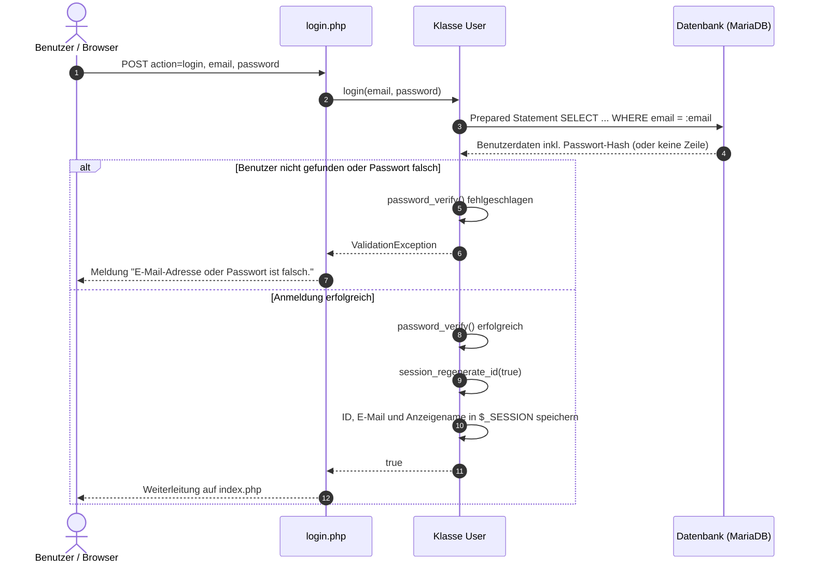

# Dokumentation: Architektur und Sicherheitsmaßnahmen der Authentifizierung

## 1. Übersicht und Schichtenarchitektur

Das Modul zur Registrierung und Anmeldung trennt Darstellung, Logik und Datenzugriff (**Separation of Concerns**). Die Seiten enthalten nur Formularverarbeitung und Ausgabe, die Geschäftslogik und alle SQL-Abfragen liegen in der Klasse `Classes\User`.

### Systemarchitektur

- **Präsentationsschicht (Seiten im Projektverzeichnis):**
    - `index.php`: Einstiegspunkt. Leitet nicht angemeldete Nutzer auf `login.php` weiter, zeigt angemeldeten Nutzern eine Startseite (Platzhalter für das spätere Dashboard).
    - `login.php`: Formular für Anmeldung und Registrierung (zwei Tabs), verarbeitet beide POST-Aktionen.
    - `logout.php`: Meldet den Nutzer ab (nur per POST) und leitet auf `login.php` weiter.
- **Logik- und Datenzugriffsschicht:**
    - `src/Classes/User.php`: Validiert Eingaben, registriert Nutzer, prüft Anmeldedaten, verwaltet die Session und kapselt alle SQL-Abfragen auf die Tabelle `users`.
    - `src/Classes/ValidationException.php`: Kennzeichnet Fehler, deren Meldung für Nutzer bestimmt ist (z. B. ungültige Eingaben).
- **Datenbankverbindung:**
    - `config/database.php`: Liest die Zugangsdaten aus `.env` und liefert über `getDatabaseConnection()` eine PDO-Verbindung zur MariaDB.

---

## 2. Ablauf der Authentifizierung (Sequenzdiagramm)

Das folgende Mermaid-Diagramm zeigt den Ablauf eines Anmeldeversuchs durch die einzelnen Schichten:

Die Registrierung verläuft analog: `login.php` prüft, ob beide Passwörter übereinstimmen, und ruft `User::register()` auf. Bei Erfolg wechselt die Seite mit einer Erfolgsmeldung zum Login-Tab.

---

## 3. Sicherheitsmaßnahmen und wissenschaftliche Fundierung

Bei der Implementierung wurden die Empfehlungen des **National Institute of Standards and Technology (NIST SP 800-63B-4)** sowie die **OWASP Top 10:2025** berücksichtigt.

### 3.1 Passwort-Hashing & Passwortrichtlinie

- **Implementierung:** Passwörter werden mittels `password_hash($password, PASSWORD_DEFAULT)` gehasht. PHP nutzt dabei einen kryptografisch sicheren Password-Hashing-Algorithmus (derzeit Bcrypt) inklusive automatischem, individuellem Salt. Bei der Registrierung wird eine Mindestlänge von 15 Zeichen durchgesetzt (`User::MIN_PASSWORD_LENGTH`), serverseitig und zusätzlich im Formular über `minlength`. Die Länge wird mit `mb_strlen()` in Zeichen gezählt, nicht in Bytes, damit Umlaute und Sonderzeichen korrekt zählen. Es gibt keine erzwungenen Komplexitätsregeln oder regelmäßigen Passwortwechsel.
- **Begründung & Standard:** Nach NIST SP 800-63B-4 dürfen Passwörter niemals im Klartext oder mit einfachen Hash-Funktionen (wie MD5 oder SHA-256) gespeichert werden, sondern nur mit rechenintensiven Verfahren mit Salt. Bei Single-Factor-Systemen schreibt NIST eine Mindestlänge von 15 Zeichen vor (8 Zeichen genügen nur innerhalb von MFA-Systemen). Erzwungene regelmäßige Passwortwechsel und starre Zeichenkomplexitätsregeln sollen nicht verwendet werden, stattdessen wird ein Abgleich mit Blocklisten bekannter Passwörter gefordert (National Institute of Standards and Technology [NIST], 2025; OWASP Foundation, 2025, Category A04:2025). Der Blocklisten-Abgleich ist noch nicht umgesetzt (siehe Abschnitt 4).

### 3.2 Schutz vor SQL-Injection

- **Implementierung:** Sämtliche Datenbankzugriffe in `Classes\User` laufen über Prepared Statements mit Parameter-Binding. Die PDO-Verbindung ist mit `PDO::ATTR_EMULATE_PREPARES => false` konfiguriert, sodass die Datenbank die Statements selbst vorbereitet.
- **Begründung & Standard:** Durch die strikte Trennung von SQL-Code und Benutzereingaben wird verhindert, dass eingeschleuster Code von der Datenbank ausgeführt wird (OWASP Foundation, 2025, Category A05:2025).

### 3.3 Schutz vor Session Fixation

- **Implementierung:** Nach erfolgreicher Anmeldung erneuert `User::login()` die Session-ID mittels `session_regenerate_id(true)`. Beim Abmelden leert `User::logout()` die Session, löscht das Session-Cookie und zerstört die Session. Abmelden ist nur per POST möglich, damit fremde Seiten (z. B. über ein eingebettetes Bild) niemanden abmelden können.
- **Begründung & Standard:** Die Erneuerung der Session-ID verhindert Session-Fixation-Angriffe, bei denen ein Angreifer dem Opfer eine vorab bekannte Session-ID unterschiebt (NIST, 2025; OWASP Foundation, 2025, Category A07:2025). Die Session-Cookies laufen derzeit noch mit den PHP-Standardeinstellungen; die Absicherung über `HttpOnly`, `Secure` und `SameSite` ist offen (siehe Abschnitt 4).

### 3.4 Schutz vor Cross-Site Scripting (XSS)

- **Implementierung:** Alle dynamischen Ausgaben im Frontend (Fehler- und Erfolgsmeldungen, Anzeigename bzw. E-Mail-Adresse) werden mit `htmlspecialchars()` maskiert.
- **Begründung & Standard:** Dadurch wird die ungewollte Ausführung von JavaScript-Code im Browser des Benutzers unterbunden (OWASP Foundation, 2025, Category A05:2025).

### 3.5 Fehlerbehandlung ohne Preisgabe interner Details

- **Implementierung:** Nur Fehler vom Typ `ValidationException` (ungültige Eingaben, bereits registrierte E-Mail-Adresse, falsche Anmeldedaten) werden dem Nutzer angezeigt. Alle anderen Fehler, etwa Datenbank- oder Typfehler, fängt `login.php` über `Throwable` ab, schreibt sie mit `error_log()` ins Server-Log und zeigt nur eine allgemeine Meldung. Doppelte E-Mail-Adressen erkennt der Unique-Key `uq_users_email` der Datenbank, auch bei gleichzeitigen Anfragen. Die Passwort-Parameter von `register()` und `login()` sind mit `#[\SensitiveParameter]` markiert, damit Passwörter nicht in Stack Traces und damit nicht im Log erscheinen. Bei falschen Anmeldedaten gibt es eine gemeinsame Meldung für E-Mail und Passwort.
- **Begründung & Standard:** Ausführliche Fehlermeldungen (z. B. SQL-Fehler oder Dateipfade) geben Angreifern Hinweise auf den Systemaufbau. Fehler sollen daher kontrolliert behandelt und nur intern protokolliert werden (OWASP Foundation, 2025, Category A10:2025).

### 3.6 Integrität externer Ressourcen und Serverkonfiguration

- **Implementierung:** Bootstrap wird per CDN eingebunden, jeweils mit Subresource Integrity (`integrity="sha384-…"`) und `crossorigin="anonymous"`. Der Browser führt eine Datei nur aus, wenn ihr Hash mit dem angegebenen übereinstimmt. Die `.htaccess` im Projektverzeichnis deaktiviert Verzeichnislisten (`Options -Indexes`), legt `index.php` als Startseite fest und sperrt versteckte Dateien wie `.env` (HTTP 403).
- **Begründung & Standard:** Ein manipuliertes Skript auf einem fremden Server würde sonst im Kontext der Login-Seite ausgeführt und könnte z. B. Passwörter mitlesen (OWASP Foundation, 2025, Category A08:2025). Verzeichnislisten und öffentlich erreichbare Konfigurationsdateien sind typische Fehlkonfigurationen (OWASP Foundation, 2025, Category A02:2025).

---

## 4. Offene Punkte

- **Session-Cookies absichern:** `session_set_cookie_params()` mit `httponly`, `secure` (sobald HTTPS genutzt wird) und `samesite` vor `session_start()` setzen.
- **Blocklisten-Abgleich:** Neue Passwörter gegen eine Liste bekannter bzw. kompromittierter Passwörter prüfen (NIST SP 800-63B-4).
- **CSRF-Schutz:** Die Formulare enthalten noch kein CSRF-Token.
- **Begrenzung von Anmeldeversuchen:** Es gibt noch keine Drosselung bei wiederholt falschen Anmeldedaten.
- **Dashboard:** `index.php` ist ein Platzhalter und wird durch das Dashboard ersetzt.

---

## 5. Literaturverzeichnis

- National Institute of Standards and Technology. (2025). _Digital Identity Guidelines: Authentication and Authenticator Management_ (NIST Special Publication 800-63B-4). U.S. Department of Commerce. https://pages.nist.gov/800-63-4/sp800-63b.html
- OWASP Foundation. (2025). _OWASP Top 10:2025 – The Ten Most Critical Web Application Security Risks_. https://top10.owasp.org/2025/
