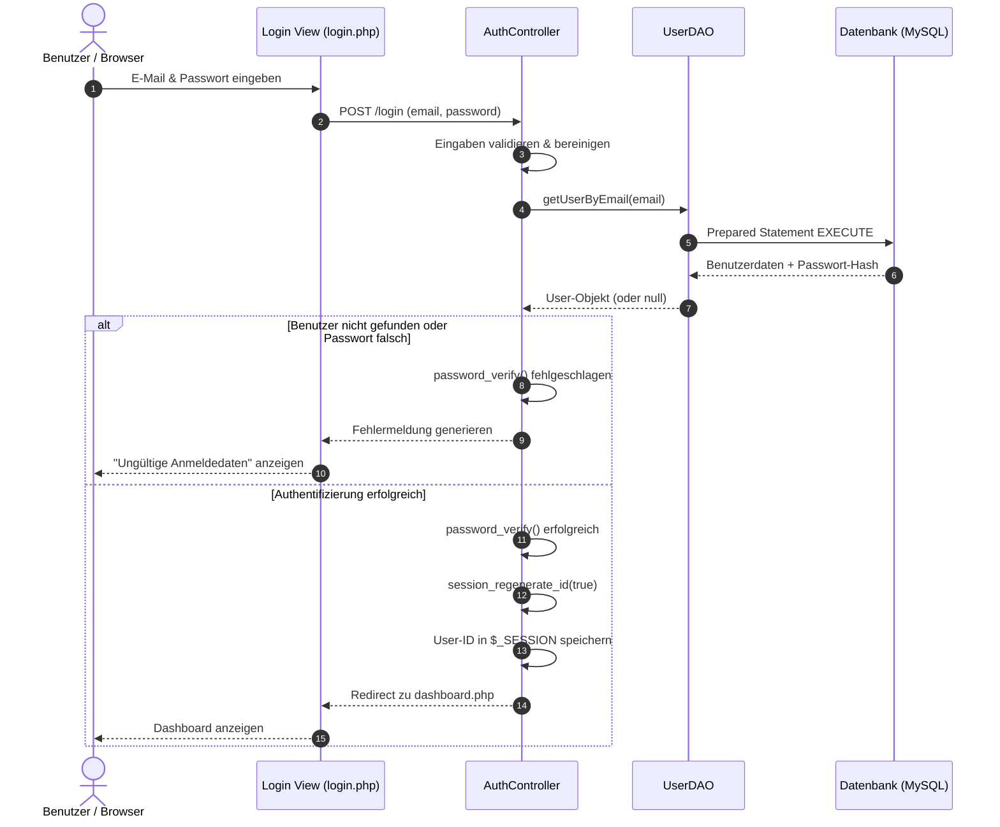

# Dokumentation: Architektur und Sicherheitsmaßnahmen der Authentifizierung

## 1. Übersicht und Schichtenarchitektur

Das Modul zur Registrierung und Anmeldung folgt dem Prinzip der **Schichtentrennung (Separation of Concerns)**. Dadurch wird die Geschäftslogik sauber von der Datenverarbeitung und der Präsentationsschicht getrennt, was die Wartbarkeit erhöht und Sicherheitsüberprüfungen vereinfacht.

### Systemarchitektur

- **Präsentationsschicht (Frontend):**
    - `register.php`: Formular zur Benutzerregistrierung.
    - `login.php`: Formular zur Benutzeranmeldung.
- **Logikschicht (Controller / Backend):**
    - `AuthController.php`: Steuert den Ablauf, validiert Benutzereingaben, führt den Passwort-Abgleich durch und verwaltet die Benutzersession.
- **Datenhaltungsschicht (Persistence):**
    - `UserDAO.php` (Data Access Object): Kapselt alle SQL-Abfragen für die Tabelle `users`.
    - `Database.php`: Verwaltet den Datenbankverbindungsaufbau via PDO.

---

## 2. Ablauf der Authentifizierung (Flussdiagramm)

Das folgende Mermaid-Diagramm visualisiert den Ablauf eines Anmeldeversuchs durch die einzelnen Schichten des Systems:

---

## 3. Sicherheitsmaßnahmen und wissenschaftliche Fundierung

Bei der Implementierung des Authentifizierungsmoduls wurden die aktuellen Standards und Empfehlungen des **National Institute of Standards and Technology (NIST SP 800-63B-4)** sowie die **OWASP Top 10:2025** berücksichtigt.

### 3.1 Passwort-Hashing & Passwortrichtlinie

- **Implementierung:** Passwörter werden vor dem Speichern in der Datenbank mittels `password_hash($password, PASSWORD_DEFAULT)` verschlüsselt. PHP nutzt hierbei standardmäßig kryptografisch sichere Password-Hashing-Algorithmen (wie Bcrypt oder Argon2id) inklusive automatischem, individuellem Salt. Bei Single-Factor-Authentifizierung wird eine Mindestlänge von 15 Zeichen durchgesetzt.
- **Begründung & Standard:** Nach der offiziellen Version des NIST SP 800-63B-4 dürfen Passwörter im Backend niemals im Klartext oder mit einfachen Hash-Funktionen (wie MD5 oder SHA-256) gespeichert werden. Es sind speicher- und rechenintensive Key-Derivation-Funktionen zu verwenden. Bei Single-Factor-Systemen schreibt NIST SP 800-63B-4 eine Mindestlänge von 15 Zeichen vor (8 Zeichen genügen nur innerhalb von MFA-Systemen). Zudem wird gefordert, erzwungene regelmäßige Passwortwechsel sowie starre Zeichenkomplexitätsregeln durch den Abgleich mit Blocklisten bekannter Passwörter zu ersetzen (National Institute of Standards and Technology [NIST], 2025; OWASP Foundation, 2025, Category A04:2025).

### 3.2 Schutz vor SQL-Injection

- **Implementierung:** Sämtliche Datenbankinteraktionen im `UserDAO` werden ausnahmslos über Prepared Statements (PDO Parameter-Binding) abgewickelt.
- **Begründung & Standard:** Durch die strikte Trennung von SQL-Code und Benutzereingaben wird verhindert, dass bösartiger Eingabecode von der Datenbank ausgeführt wird. Dies deckt die OWASP-Kategorie **A05:2025 – Injection** vollständig ab (OWASP Foundation, 2025, Category A05:2025).

### 3.3 Schutz vor Session Fixation & Session Hijacking

- **Implementierung:** Nach einer erfolgreichen Authentifizierung wird im `AuthController` die Session-ID mittels `session_regenerate_id(true)` erneuert. Zudem werden Session-Cookies mit den Flags `HttpOnly`, `Secure` und `SameSite=Strict` konfiguriert.
- **Begründung & Standard:** Die Erneuerung der Session-ID verhindert Session-Fixation-Angriffe, bei denen ein Angreifer dem Opfer eine vordefinierte Session-ID unterschiebt. Die Cookie-Attribute `HttpOnly` und `SameSite` schützen die Session-Kennung vor Diebstahl via Cross-Site Scripting (XSS) und stellen die Anforderung gemäß OWASP Top 10 **A07:2025 – Authentication Failures** dar (NIST, 2025; OWASP Foundation, 2025, Category A07:2025).

### 3.4 Validierung und Schutz vor Cross-Site Scripting (XSS)

- **Implementierung:** Alle aus der Datenbank oder aus Formularen stammenden Daten werden bei der Ausgabe im Frontend durch `htmlspecialchars()` maskiert.
- **Begründung & Standard:** Dadurch wird die ungewollte Ausführung von JavaScript-Code im Browser des Benutzers unterbunden (OWASP Foundation, 2025, Category A05:2025).

---

## 4. Literaturverzeichnis

- National Institute of Standards and Technology. (2025). _Digital Identity Guidelines: Authentication and Authenticator Management_ (NIST Special Publication 800-63B-4). U.S. Department of Commerce. https://pages.nist.gov/800-63-4/sp800-63b.html
- OWASP Foundation. (2025). _OWASP Top 10:2025 – The Ten Most Critical Web Application Security Risks_. https://top10.owasp.org/2025/
