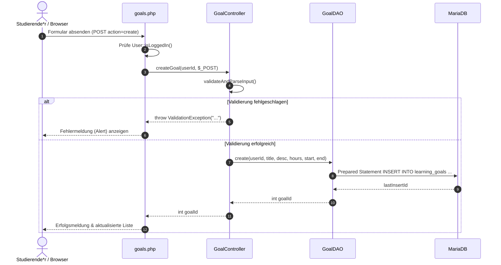

# Dokumentation: 6-Monats-Lernzielplanung (Grobplanung)

Dieses Dokument beschreibt die Architektur, Datenhaltung und Funktionsweise der langfristigen Lernzielplanung (US-1: 6-Monats-Grobplanung) im **Lernzeit-Manager** (Modul ISEF01 – Software Engineering).

---

## 1. Ziel und Zweck (Warum & Wofür)

### Wofür wurde es implementiert?
* **Langfristige Semester- und Modulplanung:** Studierende können für einen Zeitraum von 6 Monaten ihre Module und Lernziele mit geplanten Zielstunden (z. B. 150 Stunden für ein 5-ECTS-Modul), Startdatum und Enddatum erfassen, überblicken, anpassen und löschen.
* **Orientierung & Semesterübersicht:** Die Planung liefert Kennzahlen (Anzahl geplanter Module, geplante Gesamtlernzeit) und dient als Fundament für die spätere Zeiterfassung mit Stoppuhr und Soll-Ist-Vergleichen.

### Warum wurde es so implementiert? (Entwurfsprinzipien)
* **Separation of Concerns (SoC) & MVC/DAO-Muster:** Klare Trennung zwischen Benutzeroberfläche ([`goals.php`](../goals.php)), Controller-/Geschäftslogik ([`src/Controllers/GoalController.php`](../src/Controllers/GoalController.php)), Datenzugriffsschicht ([`src/DAO/GoalDAO.php`](../src/DAO/GoalDAO.php)) und MariaDB-Datenbank ([`sql/schema.sql`](../sql/schema.sql)).
* **Mandantenisolation (Sicherheit):** Alle Lese-, Aktualisierungs- und Löschoperationen erzwingen die `user_id` der aktiven Benutzersitzung (`$_SESSION['user_id']`). Studierende können ausschließlich ihre eigenen Lernziele verwalten.
* **Progressive Enhancement:** Voll funktionsfähige serverbasierte Formularabwicklung via POST (Funktioniert garantiert auch ohne JavaScript) ergänzt durch Bootstrap-5-Modals zur komfortablen Interaktion.

---

## 2. Beteiligte Komponenten & Dateien

```text
lernzeit-manager/
├── assets/
│   └── js/goals.js              # Clientseitiges Befüllen der Modals (Bearbeiten, Löschen)
├── docs/
│   └── goals.md                 # Diese Dokumentation
├── goals.php                    # UI / View für 6-Monats-Grobplanung (Tabelle, Kennzahlen, Modals)
├── includes/
│   └── header.php               # Hauptnavigation mit Link "Planen"
├── index.php                    # Dashboard mit Aktions-Button "Planen"
├── sql/
│   ├── schema.sql               # Tabellenstruktur (learning_goals mit target_hours, start_date, end_date)
│   └── seed.sql                 # Synthetische Beispieldaten für Lernziele
└── src/
    ├── Classes/
    │   └── ValidationException.php # Exception für nutzerbezogene Validierungsfehler
    ├── Controllers/
    │   └── GoalController.php   # Geschäftslogik & Validierung (Pflichtfelder, Datumslogik, Stunden)
    └── DAO/
        └── GoalDAO.php          # CRUD-Operationen via PDO Prepared Statements
```

---

## 3. Datenmodell & Validierungsregeln

### 3.1 Datenbankanpassung ([sql/schema.sql](../sql/schema.sql))

Die Tabelle `learning_goals` speichert die langfristigen Lernziele der Studierenden:

```sql
CREATE TABLE learning_goals (
    id             INT UNSIGNED NOT NULL AUTO_INCREMENT,
    user_id        INT UNSIGNED NOT NULL,
    title          VARCHAR(150) NOT NULL,
    description    TEXT         NULL,
    target_hours   DECIMAL(6,2) NOT NULL,
    start_date     DATE         NOT NULL,
    end_date       DATE         NOT NULL,
    created_at     DATETIME     NOT NULL DEFAULT CURRENT_TIMESTAMP,
    PRIMARY KEY (id),
    KEY idx_learning_goals_user (user_id),
    CONSTRAINT fk_learning_goals_user FOREIGN KEY (user_id)
        REFERENCES users (id) ON DELETE CASCADE,
    CONSTRAINT chk_learning_goals_dates CHECK (end_date >= start_date)
) ENGINE=InnoDB DEFAULT CHARSET=utf8mb4 COLLATE=utf8mb4_unicode_ci;
```

* `target_hours`: Geplante Stunden als Dezimalwert (z. B. `150.00`).
* `start_date` / `end_date`: Definieren das Planungszeitfenster (6-Monats-Horizont).
* `chk_learning_goals_dates`: Stellt auf Datenbankebene sicher, dass das Enddatum nicht vor dem Startdatum liegt.
* `fk_learning_goals_user`: Löscht bei Entfernung eines Benutzerkontos kaskadierend alle zugeordneten Lernziele (`ON DELETE CASCADE`).

### 3.2 Validierungsregeln in [`Controllers\GoalController`](../src/Controllers/GoalController.php)

* **Modul / Lernzielname (`title`):** Pflichtfeld, nicht leer, maximal 150 Zeichen (`GoalController::MAX_TITLE_LENGTH`).
* **Zielstunden (`target_hours`):** Pflichtfeld, numerisch, zwischen 0,5 und 1500,0 Stunden. Unterstützt sowohl Komma (`120,5`) als auch Punkt (`120.5`) als Dezimaltrennzeichen.
* **Startdatum (`start_date`):** Pflichtfeld im ISO-Format `JJJJ-MM-TT` (`Y-m-d`).
* **Enddatum (`end_date`):** Pflichtfeld im ISO-Format `JJJJ-MM-TT` (`Y-m-d`). Muss zeitlich am oder nach dem Startdatum liegen (`end_date >= start_date`).
* **Beschreibung (`description`):** Optional, maximal 2000 Zeichen. Leere Zeichenketten werden in der Datenbank als `NULL` abgelegt.

---

## 4. Schichtenarchitektur & Ablauf

### 4.1 Data Access Object ([`src/DAO/GoalDAO.php`](../src/DAO/GoalDAO.php))
Kapselt sämtliche Datenbankinteraktionen und stellt atomare Methoden bereit:
* `create(int $userId, string $title, ?string $description, float $targetHours, string $startDate, string $endDate): int`
* `findAllByUserId(int $userId): array`
* `findByIdAndUserId(int $goalId, int $userId): ?array`
* `update(int $goalId, int $userId, string $title, ?string $description, float $targetHours, string $startDate, string $endDate): bool`
* `delete(int $goalId, int $userId): bool`
* `getTotalTargetHours(int $userId): float`

### 4.2 Ablauf eines Erstellvorgangs (Sequenzdiagramm)



---

## 5. Sicherheitsmaßnahmen

1. **Schutz vor SQL-Injection:** Sämtliche Datenbankabfragen in `GoalDAO` werden ausnahmslos mit Prepared Statements und streng typisierten Bind-Parametern (`:user_id`, `:title`, `:description`, etc.) ausgeführt.
2. **Schutz vor Cross-Site-Scripting (XSS):** Alle dynamischen Inhalte in `goals.php` (z. B. Modultitel, Notizen, Datumsangaben) werden bei der Ausgabe konsequent mit `htmlspecialchars()` maskiert.
3. **Mandantenisolation & IDOR-Schutz:** Sämtliche CRUD-Operationen (`SELECT`, `UPDATE`, `DELETE`) binden zwingend die aktuelle `user_id` aus `$_SESSION['user_id']`. Ein Manipulieren von IDs in POST-Anfragen kann keine fremden Datensätze beeinflussen.
4. **Sichere Löschoperationen:** Löschungen erfolgen ausschließlich per HTTP POST mit explizitem Formular und Bestätigungs-Modal (keine manipulierbaren GET-Links).

