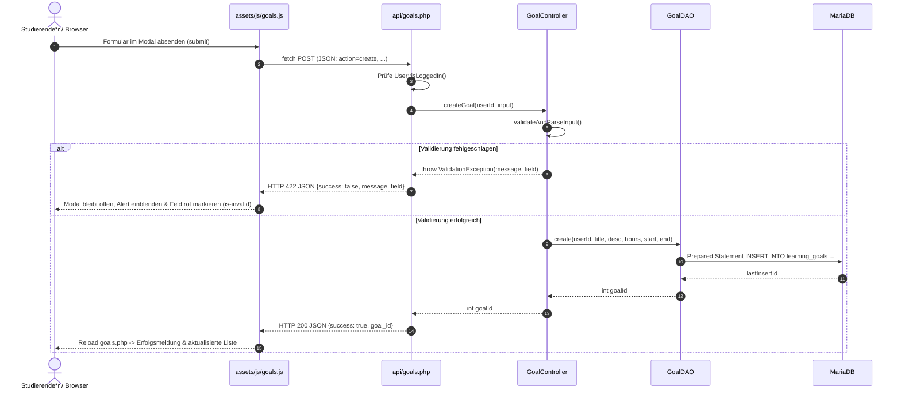

# Dokumentation: 6-Monats-Lernzielplanung, Monats- & Wochenplanung

Dieses Dokument beschreibt die Architektur, Datenhaltung und Funktionsweise der langfristigen Lernzielplanung (Issue #1: 6-Monats-Grobplanung), der monatlichen Detail- und Workload-Planung (Issue #2: Monatliche Grobplanung & Zwischenziele) sowie der wöchentlichen Detailplanung inklusive verfügbarer Lern-Timeslots (Issue #3: Wöchentliche Detailplanung) im **Lernzeit-Manager** (Modul ISEF01 – Software Engineering).

---

## 1. Ziel und Zweck (Warum & Wofür)

### Wofür wurde es implementiert?
* **Langfristige Semester- und Modulplanung (6 Monate):** Studierende können für einen Zeitraum von 6 Monaten ihre Module und Lernziele mit geplanten Zielstunden (z. B. 150 Stunden für ein 5-ECTS-Modul), Startdatum und Enddatum erfassen, überblicken, anpassen und löschen.
* **Monatliche Detailplanung & Zwischenziele (1 Monat):** Die übergeordneten 6-Monats-Lernziele lassen sich in konkrete monatliche Zwischenziele mit eigenem Stundenkontingent herunterbrechen. Zusätzlich kann je Monat ein persönliches Soll-Zeitbudget hinterlegt werden.
* **Wöchentliche Detailplanung & verfügbare Timeslots (1 Woche):** Innerhalb jedes Kalendermonats können die monatlichen Zwischenziele auf Kalenderwochen (KW) und konkrete Wochentage (Montag bis Sonntag) heruntergebrochen werden. Studierende tragen ihre tatsächlich verfügbaren Lern-Timeslots mit freier Start- und Endzeit (`HH:MM`) ein, ordnen sie einem Zwischenziel zu und können absolvierte Einheiten als erledigt markieren.
* **Prozentuale Workload-Verteilung, Überplanungs- & Kollisions-Warnung:** Das System berechnet die Auslastung auf Semester-, Monats- und Wochenebene. Überschreitungen eines 6-Monats-Ziels, eines Monatsbudgets, eines Zwischenziels oder zeitliche Überschneidungen zweier Timeslots am selben Tag werden farblich (Gelb/Warnhinweis) hervorgehoben.

### Warum wurde es so implementiert? (Entwurfsprinzipien)
* **Separation of Concerns (SoC) & MVC/DAO-Muster:** Klare Trennung zwischen Benutzeroberfläche ([`goals.php`](../goals.php)), Controller-/Geschäftslogik ([`src/Controllers/GoalController.php`](../src/Controllers/GoalController.php)), Datenzugriffsschicht ([`src/DAO/GoalDAO.php`](../src/DAO/GoalDAO.php)) und MariaDB-Datenbank ([`sql/schema.sql`](../sql/schema.sql)).
* **Mandantenisolation (Sicherheit):** Alle Lese-, Aktualisierungs- und Löschoperationen erzwingen die `user_id` der aktiven Benutzersitzung (`$_SESSION['user_id']`). Studierende können ausschließlich ihre eigenen Lernziele verwalten.
* **Progressive Enhancement & Asynchrone Formularverarbeitung:** Alle Formulare zum Anlegen und Bearbeiten (Lernziele, Monatsbudget, Zwischenziele) werden per Fetch-API an [`api/goals.php`](../api/goals.php) übermittelt, sodass das Modal bei Validierungsfehlern geöffnet bleibt, Nutzereingaben nicht verloren gehen und fehlerhafte Eingabefelder direkt mit `is-invalid` rot markiert werden. Ergänzt durch einen serverseitigen POST-Fallback in [`goals.php`](../goals.php); Löschungen laufen direkt über diesen POST-Weg.

---

## 2. Beteiligte Komponenten & Dateien

```text
lernzeit-manager/
├── api/
│   └── goals.php                # JSON-Endpunkt für asynchrone CRUD-Operationen & Validierungsfeedback
├── assets/
│   └── js/goals.js              # Asynchrone Formularverarbeitung (Fetch), Fehler-Markierung & Modal-Steuerung
├── docs/
│   └── goals.md                 # Diese Dokumentation
├── goals.php                    # UI / View für 6-Monats-Grobplanung (Tabelle, Kennzahlen, Modals)
├── includes/
│   └── header.php               # Hauptnavigation mit Link "Planen"
├── index.php                    # Dashboard mit Aktions-Button "Planen"
├── sql/
│   ├── schema.sql               # Tabellenstruktur (learning_goals mit target_hours, start_date, end_date)
│   └── seed.sql                 # Synthetische Beispieldaten für Lernziele
└── src/
    ├── Classes/
    │   └── ValidationException.php # Exception für nutzerbezogene Validierungsfehler (inkl. Feldzuordnung)
    ├── Controllers/
    │   └── GoalController.php   # Geschäftslogik & Validierung (Pflichtfelder, Datumslogik, Stunden)
    └── DAO/
        └── GoalDAO.php          # CRUD-Operationen via PDO Prepared Statements
```

---

## 3. Datenmodell & Validierungsregeln

### 3.1 Datenbankanpassung ([sql/schema.sql](../sql/schema.sql))

Die Tabelle `learning_goals` speichert die langfristigen Lernziele der Studierenden:

```sql
CREATE TABLE learning_goals (
    id             INT UNSIGNED NOT NULL AUTO_INCREMENT,
    user_id        INT UNSIGNED NOT NULL,
    title          VARCHAR(150) NOT NULL,
    description    TEXT         NULL,
    target_hours   DECIMAL(6,2) NOT NULL,
    start_date     DATE         NOT NULL,
    end_date       DATE         NOT NULL,
    created_at     DATETIME     NOT NULL DEFAULT CURRENT_TIMESTAMP,
    PRIMARY KEY (id),
    KEY idx_learning_goals_user (user_id),
    CONSTRAINT fk_learning_goals_user FOREIGN KEY (user_id)
        REFERENCES users (id) ON DELETE CASCADE,
    CONSTRAINT chk_learning_goals_dates CHECK (end_date >= start_date)
) ENGINE=InnoDB DEFAULT CHARSET=utf8mb4 COLLATE=utf8mb4_unicode_ci;
```

* `target_hours`: Geplante Stunden als Dezimalwert (z. B. `150.00`).
* `start_date` / `end_date`: Definieren das Planungszeitfenster (6-Monats-Horizont).
* `chk_learning_goals_dates`: Stellt auf Datenbankebene sicher, dass das Enddatum nicht vor dem Startdatum liegt.
* `fk_learning_goals_user`: Löscht bei Entfernung eines Benutzerkontos kaskadierend alle zugeordneten Lernziele (`ON DELETE CASCADE`).

Für die monatliche Detailplanung und die Zuordnung der Lernziele zu einzelnen Monaten ergänzen zwei weitere Tabellen das Schema:

```sql
CREATE TABLE monthly_budgets (
    id           INT UNSIGNED NOT NULL AUTO_INCREMENT,
    user_id      INT UNSIGNED NOT NULL,
    plan_month   CHAR(7)      NOT NULL,
    budget_hours DECIMAL(6,2) NOT NULL,
    created_at   DATETIME     NOT NULL DEFAULT CURRENT_TIMESTAMP,
    PRIMARY KEY (id),
    UNIQUE KEY uq_monthly_budgets_user_month (user_id, plan_month),
    CONSTRAINT fk_monthly_budgets_user FOREIGN KEY (user_id)
        REFERENCES users (id) ON DELETE CASCADE,
    CONSTRAINT chk_monthly_budgets_hours CHECK (budget_hours >= 0)
) ENGINE=InnoDB DEFAULT CHARSET=utf8mb4 COLLATE=utf8mb4_unicode_ci;

CREATE TABLE monthly_goals (
    id            INT UNSIGNED NOT NULL AUTO_INCREMENT,
    user_id       INT UNSIGNED NOT NULL,
    goal_id       INT UNSIGNED NOT NULL,
    plan_month    CHAR(7)      NOT NULL,
    title         VARCHAR(150) NOT NULL,
    description   TEXT         NULL,
    planned_hours DECIMAL(6,2) NOT NULL,
    created_at    DATETIME     NOT NULL DEFAULT CURRENT_TIMESTAMP,
    PRIMARY KEY (id),
    KEY idx_monthly_goals_user_month (user_id, plan_month),
    KEY idx_monthly_goals_goal (goal_id),
    CONSTRAINT fk_monthly_goals_user FOREIGN KEY (user_id)
        REFERENCES users (id) ON DELETE CASCADE,
    CONSTRAINT fk_monthly_goals_goal FOREIGN KEY (goal_id)
        REFERENCES learning_goals (id) ON DELETE CASCADE,
    CONSTRAINT chk_monthly_goals_hours CHECK (planned_hours > 0)
) ENGINE=InnoDB DEFAULT CHARSET=utf8mb4 COLLATE=utf8mb4_unicode_ci;
```

* `monthly_budgets`: Speichert das persönliche Soll-Zeitbudget (`budget_hours`) je Studierendem und Kalendermonat (`plan_month` im Format `YYYY-MM`).
* `monthly_goals`: Speichert die heruntergebrochenen monatlichen Zwischenziele (`title`, `planned_hours`, `description`), verknüpft mit dem übergeordneten 6-Monats-Lernziel (`goal_id`). Wird ein 6-Monats-Lernziel gelöscht, werden dessen Zwischenziele per `ON DELETE CASCADE` automatisch mitentfernt.

Für die wöchentliche Detailplanung und die Einteilung tatsächlicher Lern-Timeslots ergänzt die Tabelle `learning_slots` das Schema:

```sql
CREATE TABLE learning_slots (
    id              INT UNSIGNED NOT NULL AUTO_INCREMENT,
    user_id         INT UNSIGNED NOT NULL,
    monthly_goal_id INT UNSIGNED NOT NULL,
    slot_date       DATE         NOT NULL,
    start_time      TIME         NOT NULL,
    end_time        TIME         NOT NULL,
    notes           VARCHAR(255) NULL     DEFAULT NULL,
    is_completed    TINYINT(1)   NOT NULL DEFAULT 0,
    created_at      DATETIME     NOT NULL DEFAULT CURRENT_TIMESTAMP,
    PRIMARY KEY (id),
    KEY idx_learning_slots_user_date (user_id, slot_date),
    KEY idx_learning_slots_monthly_goal (monthly_goal_id),
    CONSTRAINT fk_learning_slots_user FOREIGN KEY (user_id)
        REFERENCES users (id) ON DELETE CASCADE,
    CONSTRAINT fk_learning_slots_monthly_goal FOREIGN KEY (monthly_goal_id)
        REFERENCES monthly_goals (id) ON DELETE CASCADE,
    CONSTRAINT chk_learning_slots_time CHECK (end_time > start_time)
) ENGINE=InnoDB DEFAULT CHARSET=utf8mb4 COLLATE=utf8mb4_unicode_ci;
```

* `learning_slots`: Speichert die konkret eingeplanten Lern-Timeslots an einem Datum (`slot_date`) mit freier Start- und Endzeit (`start_time`, `end_time`), optionaler Lernnotiz (`notes`) und Erledigt-Status (`is_completed`), verknüpft mit einem monatlichen Zwischenziel (`monthly_goal_id`).

### 3.2 Validierungsregeln in [`Controllers\GoalController`](../src/Controllers/GoalController.php)

* **Modul / Lernzielname (`title`):** Pflichtfeld, nicht leer, maximal 150 Zeichen (`GoalController::MAX_TITLE_LENGTH`).
* **Zielstunden (`target_hours`):** Pflichtfeld, numerisch, zwischen 0,5 und 1500,0 Stunden. Unterstützt sowohl Komma (`120,5`) als auch Punkt (`120.5`) als Dezimaltrennzeichen.
* **Startdatum (`start_date`):** Pflichtfeld im ISO-Format `JJJJ-MM-TT` (`Y-m-d`).
* **Enddatum (`end_date`):** Pflichtfeld im ISO-Format `JJJJ-MM-TT` (`Y-m-d`). Muss zeitlich am oder nach dem Startdatum liegen (`end_date >= start_date`).
* **Beschreibung (`description`):** Optional, maximal 2000 Zeichen. Leere Zeichenketten werden in der Datenbank als `NULL` abgelegt.
* **Monat (`year_month`):** Pflichtfeld im Format `JJJJ-MM` (`^\d{4}-(0[1-9]|1[0-2])$`).
* **Monatliches Soll-Zeitbudget (`budget_hours`):** Numerisch zwischen 0,0 und 744,0 Stunden (`GoalController::MAX_MONTHLY_HOURS`). Bei leerem Wert oder `0` wird das hinterlegte Monatsbudget zurückgesetzt.
* **Zwischenziel-Monat (`year_month`):** Pflichtfeld im Format JJJJ-MM. Der Monat muss im Zeitraum des zugehörigen Lernziels liegen (Vergleich auf Monatsebene zwischen `start_date` und `end_date`).
* **Zwischenziel-Stunden (`planned_hours`):** Pflichtfeld, numerisch zwischen 0,5 und 744,0 Stunden. Überschreitet die Summe der Zwischenziele die Zielstunden des 6-Monats-Ziels oder das Monatsbudget, bleibt das Speichern erlaubt und die Oberfläche hebt die Überschreitung farblich hervor.
* **Timeslot-Datum (`slot_date`):** Pflichtfeld im Format `JJJJ-MM-TT`. Muss im Zeitraum des übergeordneten Lernziels sowie im Monat des zugeordneten Zwischenziels (inkl. überlappender Kalenderwochen an den Monatsrändern) liegen.
* **Timeslot-Uhrzeit (`start_time`, `end_time`):** Pflichtfelder im Format `HH:MM`. `end_time` muss zeitlich nach `start_time` liegen, mit einer Mindestdauer von 15 Minuten (`GoalController::MIN_SLOT_MINUTES`). Zeitliche Überschneidungen am selben Tag werden erkannt und in der Wochenansicht als Kollision hervorgehoben.
* **Timeslot-Notiz (`notes`):** Optional, maximal 255 Zeichen (`GoalController::MAX_SLOT_NOTES_LENGTH`).

---

## 4. Schichtenarchitektur & Ablauf

### 4.1 Data Access Object ([`src/DAO/GoalDAO.php`](../src/DAO/GoalDAO.php))
Kapselt sämtliche Datenbankinteraktionen und stellt atomare Methoden bereit:
* `create(int $userId, string $title, ?string $description, float $targetHours, string $startDate, string $endDate): int`
* `findAllByUserId(int $userId): array`
* `findByIdAndUserId(int $goalId, int $userId): ?array`
* `update(int $goalId, int $userId, string $title, ?string $description, float $targetHours, string $startDate, string $endDate): bool`
* `delete(int $goalId, int $userId): bool`
* `getTotalTargetHours(int $userId): float`

### 4.2 Ablauf eines Erstellvorgangs (Sequenzdiagramm)



---

## 5. Sicherheitsmaßnahmen

1. **Schutz vor SQL-Injection:** Sämtliche Datenbankabfragen in `GoalDAO` werden ausnahmslos mit Prepared Statements (`PDO::ATTR_EMULATE_PREPARES => false`) und streng typisierten Bind-Parametern (`:user_id`, `:title`, `:description`, etc.) ausgeführt.
2. **Schutz vor Cross-Site-Scripting (XSS):** Alle dynamischen Inhalte in `goals.php` (z. B. Modultitel, Notizen, Datumsangaben) werden bei der Ausgabe konsequent mit `htmlspecialchars()` maskiert; im JavaScript (`assets/js/goals.js`) werden Modalfelder über `.value` und `.textContent` befüllt.
3. **Mandantenisolation & IDOR-Schutz:** Sämtliche CRUD-Operationen (`SELECT`, `UPDATE`, `DELETE`) sowie das Zuordnen eines Zwischenziels zu einem übergeordneten Lernziel (`goal_id`) binden zwingend die aktuelle `user_id` aus `$_SESSION['user_id']`. Ein Manipulieren von IDs in POST-Anfragen kann keine fremden Datensätze lesen, zuordnen oder verändern.
4. **CSRF-Schutz (Cross-Site Request Forgery):** Jedes schreibende Formular auf `goals.php` überträgt ein kryptografisch sicheres Session-Token (`csrf_token` via `random_bytes(32)`), das serverseitig zeitkonstant mittels `hash_equals()` geprüft wird – sowohl im POST-Fallback von `goals.php` als auch in `api/goals.php` (dort HTTP 403 bei fehlendem oder falschem Token).
5. **Sichere Löschoperationen:** Löschungen erfolgen ausschließlich per HTTP POST mit CSRF-Token und Bestätigungs-Modal (keine manipulierbaren GET-Links).

