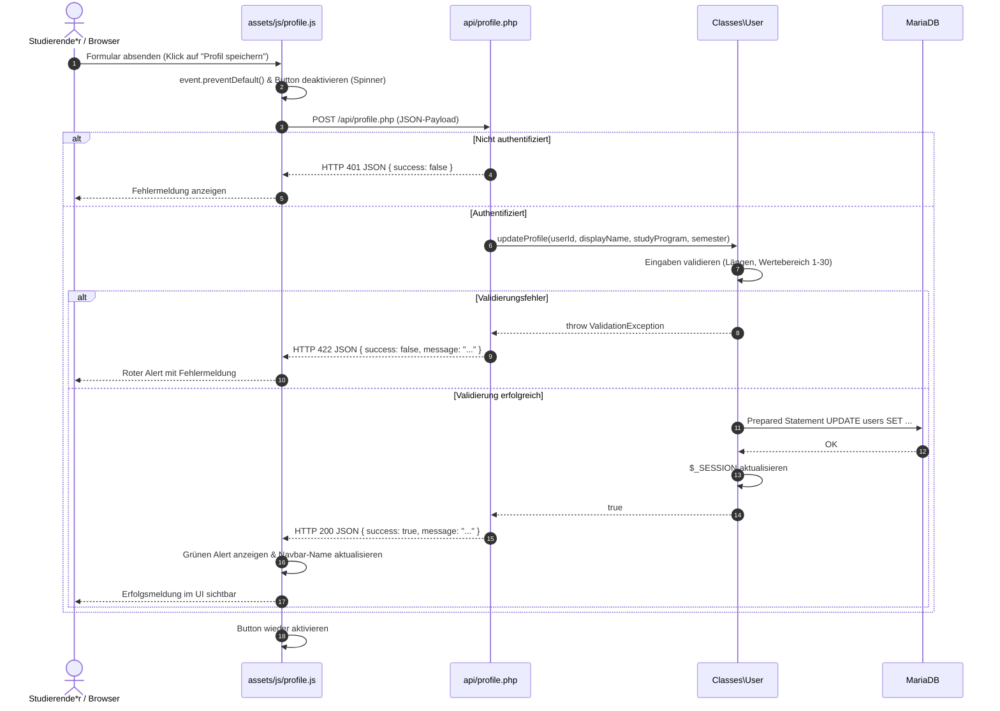

# Dokumentation: Profilverwaltung und grundlegendes Webseiten-Design

Dieses Dokument beschreibt die Architektur, Funktionsweise und Entwurfsentscheidungen der Profilverwaltung sowie des grundlegenden Seitenlayouts im **Lernzeit-Manager** (Modul ISEF01 – Software Engineering).

---

## 1. Ziel und Zweck (Warum & Wofür)

### Wofür wurde es implementiert?
1. **Pflege akademischer Stammdaten:** Studierende können in ihrem Profil ihren Studiengang und ihr aktuelles Fachsemester hinterlegen sowie ihren Anzeigenamen anpassen. Diese Angaben dienen der Personalisierung der Anwendung und bilden das Fundament für künftige Features (z. B. semesterbezogene Lernzeit-Statistiken und Modulzuordnungen).
2. **Einheitliches Layout-Fundament:** Einführung eines konsistenten visuellen Rahmens für alle Seiten der Webanwendung durch modulare Header- und Footer-Komponenten, ein responsives Navigationsmenü, ein Favicon und ein Sticky-Footer-Design.

### Warum wurde es so implementiert? (Entwurfsprinzipien)
- **DRY-Prinzip (*Don't Repeat Yourself*):** Wiederkehrende HTML-Strukturen (HTML5-Doctype, Meta-Tags, Viewport, CDN-Assets, Navigation und Footer) werden in zentralen Include-Dateien (`includes/header.php` und `includes/footer.php`) verwaltet. Seiten wie `index.php` und `profile.php` enthalten dadurch nur noch ihren spezifischen Seiteninhalt.
- **Separation of Concerns (SoC):** Strikte Trennung zwischen Frontend-Präsentation (HTML5/Bootstrap 5), API-Kommunikation (JSON-Endpunkt), Geschäftslogik/Validierung (`src/Classes/User.php`) und persistenter Datenspeicherung (MariaDB).
- **Progressive Enhancement:** Die Profilseite unterstützt die moderne asynchrone Datenübertragung via Vanilla JS (`fetch`-API) ohne Seiten-Reload, bleibt aber durch serverseitige Fallback-Verarbeitung auch bei deaktiviertem JavaScript voll funktionsfähig.

---

## 2. Architektur und Komponenten

### Übersicht der beteiligten Dateien

```text
lernzeit-manager/
├── api/
│   └── profile.php          # Schlanker JSON-Endpunkt für asynchrone fetch()-Anfragen
├── assets/
│   ├── css/custom.css       # Ergänzendes Styling (Flexbox für Sticky-Footer)
│   ├── img/favicon.png      # Projekt-Favicon und Navbar-Markenlogo
│   └── js/profile.js        # Clientseitige Logik (Event-Handling, fetch, UI-Feedback)
├── docs/
│   └── profilverwaltung.md  # Diese Dokumentation
├── includes/
│   ├── header.php           # Globaler Kopfbereich (Head, Meta, Favicon, Bootstrap-Navbar)
│   └── footer.php           # Globaler Fußbereich (Sticky Footer, Bootstrap-Bundle JS)
├── index.php                # Startseite/Dashboard mit Anzeige der Profildaten
├── profile.php              # UI-Formular für Stammdaten (Studiengang, Semester, Name)
├── sql/
│   ├── schema.sql           # Tabellenstruktur (Spalten study_program und semester)
│   └── seed.sql             # Synthetische Testdaten inkl. Studiengang/Semester
└── src/Classes/
    └── User.php             # OOP-Methoden findById() und updateProfile() mit Validierung
```

---

## 3. Funktionsweise im Detail

### 3.1 Datenbankanpassung (`sql/schema.sql` & `sql/seed.sql`)
Die Tabelle `users` wurde um zwei optionale Spalten erweitert:
- `study_program` (`VARCHAR(150) NULL DEFAULT NULL`): Speichert den Namen des Studiengangs.
- `semester` (`TINYINT UNSIGNED NULL DEFAULT NULL`): Speichert das Fachsemester als numerischen Wert (spart Speicherplatz und erzwingt Ganzzahlen).

### 3.2 Backend-Logik & Validierung (`src/Classes/User.php`)
Die Klasse `User` kapselt sämtliche SQL-Abfragen und erzwingt fachliche Validierungsregeln:
- **`findById(int $userId): ?array`**: Lädt die aktuellen Profildaten des angemeldeten Nutzers via Prepared Statement.
- **`updateProfile(int $userId, string $displayName, ?string $studyProgram, ?int $semester): bool`**:
  - `displayName`: Kürzen von Leerzeichen (`trim`), maximal 100 Zeichen (`User::MAX_DISPLAY_NAME_LENGTH`).
  - `studyProgram`: Optional; maximal 150 Zeichen (`User::MAX_STUDY_PROGRAM_LENGTH`).
  - `semester`: Optional; muss im gültigen Bereich von 1 bis 30 liegen (`User::MIN_SEMESTER` bis `User::MAX_SEMESTER`).
  - Bei Erfolg wird die aktive PHP-Session (`$_SESSION['user_display_name']`, `$_SESSION['user_study_program']`, `$_SESSION['user_semester']`) direkt synchronisiert.
  - Fachliche Fehler werfen eine `ValidationException` mit anwenderfreundlicher Botschaft.

### 3.3 Asynchrone Schnittstelle (`api/profile.php` & `assets/js/profile.js`)
1. Der Browser sendet ein JSON-Objekt via HTTP-POST an `api/profile.php`.
2. Der Endpunkt prüft:
   - Ist der Nutzer angemeldet (`User::isLoggedIn()`)? Wenn nein: HTTP 401 Unauthorized.
   - Ist die HTTP-Methode POST? Wenn nein: HTTP 405 Method Not Allowed.
3. Die Eingabedaten werden an `User::updateProfile()` übergeben.
4. Bei Erfolg antwortet der Server mit HTTP 200 und JSON `{ "success": true, ... }`.
5. Validierungsfehler liefern HTTP 422 Unprocessable Entity mit Fehlermeldung; unerwartete Systemfehler HTTP 500 (Details wandern nur ins Server-Log via `error_log()`).
6. `profile.js` wertet die Antwort aus, blendet dynamisch einen Bootstrap-Alert ein und aktualisiert den Nutzernamen in der Navigation, ohne die Seite neu zu laden.

---

## 4. Ablauf der Profilaktualisierung (Sequenzdiagramm)



---

## 5. Layout & Responsives Webdesign

- **Bootstrap 5 Navbar (`includes/header.php`):**
  - Verwendet `navbar-expand-md`: Auf Bildschirmen $\ge 768\text{ px}$ voll sichtbar, auf kleineren Mobilgeräten einklappbar als Hamburger-Menü (`navbar-toggler` und `collapse navbar-collapse`).
  - Das Favicon (`assets/img/favicon.png`) dient links als Markenlogo und direkter Home-Link zum Dashboard (`index.php`).
  - Der Logout-Button ist in ein HTML-Formular mit `method="POST"` eingebettet, um unabsichtliches oder manipuliertes Abmelden über fremde Webseiten (z. B. via Bild-Tags) auszuschließen.
- **Sticky Footer (`assets/css/custom.css` & `includes/footer.php`):**
  - Durch ein CSS-Flexbox-Konstrukt (`body { min-height: 100vh; display: flex; flex-direction: column; }` und `main { flex: 1 0 auto; }`) schließt der Footer selbst auf Seiten mit minimalem Inhalt exakt am unteren Bildschirmrand ab, ohne Inhalte zu überdecken.

---

## 6. Sicherheitsaspekte

1. **SQL-Injection-Prävention:** Alle Aktualisierungen und Abfragen erfolgen ausnahmslos über PDO Prepared Statements mit Parameterbindung (`:id`, `:display_name`, `:study_program`, `:semester`).
2. **Cross-Site-Scripting (XSS):** Sämtliche dynamisch ausgegebenen Werte (Benutzername, E-Mail, Studiengang) werden im HTML mit `htmlspecialchars()` maskiert.
3. **Integrität externer Skripte:** Bootstrap 5 wird über das CDN mit Subresource Integrity (`integrity="sha384-..."`) eingebunden.
4. **Fehlermaskierung:** Interne Datenbankfehler werden niemals im Frontend oder in JSON-Antworten offengelegt, sondern serverseitig protokolliert.

