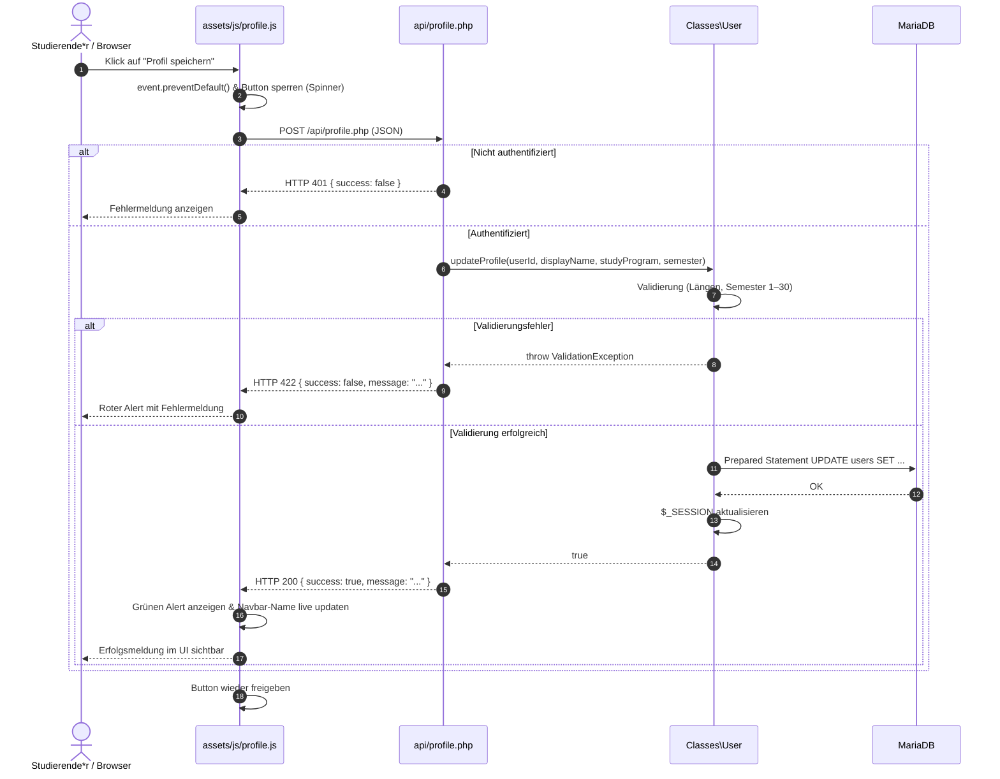

# Dokumentation: Profilverwaltung (Studiengang, Semester & Profildaten)

Dieses Dokument beschreibt die Architektur, Datenhaltung und Funktionsweise der Profilverwaltung im **Lernzeit-Manager** (Modul ISEF01 – Software Engineering).

---

## 1. Ziel und Zweck (Warum & Wofür)

### Wofür wurde es implementiert?
* **Pflege akademischer Stammdaten:** Studierende können in ihrem Profil ihren Studiengang und ihr aktuelles Fachsemester eintragen und aktualisieren sowie ihren Anzeigenamen anpassen.
* **Personalisierung & Datengrundlage:** Die Angaben ermöglichen eine persönliche Ansprache im Dashboard und bilden das Fundament für spätere Funktionen (z. B. semesterbezogene Lernzeit-Statistiken und Modulzuordnungen).

### Warum wurde es so implementiert? (Entwurfsprinzipien)
* **Separation of Concerns (SoC):** Strikte Trennung zwischen Benutzeroberfläche ([profile.php](../profile.php)), asynchroner API ([api/profile.php](../api/profile.php)), Geschäftslogik/Validierung ([src/Classes/User.php](../src/Classes/User.php)) und Datenbank ([sql/schema.sql](../sql/schema.sql)).
* **Progressive Enhancement:** Das Formular sendet Daten primär asynchron via Vanilla JS (`fetch`-API) ohne Neuladen der Seite ab. Für Browser ohne JavaScript existiert ein serverseitiger POST-Fallback direkt in [profile.php](../profile.php).

---

## 2. Beteiligte Komponenten & Dateien

```text
lernzeit-manager/
├── api/
│   └── profile.php          # Schlanker JSON-Endpunkt für asynchrone fetch()-Anfragen
├── assets/
│   └── js/profile.js        # Clientseitige Logik (Event-Handling, fetch, UI-Feedback)
├── docs/
│   └── profilverwaltung.md  # Diese Dokumentation
├── profile.php              # UI-Formular für Stammdaten (Studiengang, Semester, Name)
├── sql/
│   ├── schema.sql           # Tabellenstruktur (Spalten study_program und semester)
│   └── seed.sql             # Synthetische Testdaten inkl. Studiengang/Semester
└── src/Classes/
    ├── User.php             # OOP-Methoden findById() und updateProfile() mit Validierung
    └── ValidationException.php # Exception für anwenderbezogene Fehlermeldungen
```

---

## 3. Datenmodell & Validierungsregeln

### Datenbankanpassung ([sql/schema.sql](../sql/schema.sql))
In der Tabelle `users` wurden zwei optionale Spalten ergänzt:
* `study_program` (`VARCHAR(150) NULL DEFAULT NULL`): Speichert den Namen des Studiengangs (z. B. „Informatik B.Sc.“).
* `semester` (`TINYINT UNSIGNED NULL DEFAULT NULL`): Speichert das Fachsemester als numerischen Wert (spart Speicher und erzwingt Ganzzahlen).

### Validierungsregeln in [`Classes\User`](../src/Classes/User.php)
* **Anzeigename (`display_name`):** Optional, maximal 100 Zeichen (`User::MAX_DISPLAY_NAME_LENGTH`).
* **Studiengang (`study_program`):** Optional, maximal 150 Zeichen (`User::MAX_STUDY_PROGRAM_LENGTH`). Leere Eingaben werden als `NULL` gespeichert.
* **Semester (`semester`):** Optional, muss als Ganzzahl zwischen 1 und 30 liegen (`User::MIN_SEMESTER` bis `User::MAX_SEMESTER`).
* **E-Mail-Adresse:** Dient als systemweiter Login-Identifier und ist im Profil schreibgeschützt (`disabled`).
* **Session-Synchronisation:** Bei erfolgreicher Aktualisierung aktualisiert `updateProfile()` unmittelbar die Session-Variablen (`$_SESSION['user_display_name']`, `$_SESSION['user_study_program']`, `$_SESSION['user_semester']`).

---

## 4. Asynchrone Schnittstelle & Client-Logik

### [api/profile.php](../api/profile.php)
* **Zugriffskontrolle:** Nur für authentifizierte Nutzer (`User::isLoggedIn()`), sonst HTTP 401 Unauthorized.
* **Methodenprüfung:** Akzeptiert ausschließlich POST-Anfragen, sonst HTTP 405 Method Not Allowed.
* **Payload-Verarbeitung:** Unterstützt JSON (`php://input`) sowie Standard-Formulardaten (`$_POST`).
* **HTTP-Statuscodes:**
  * `200 OK`: Profil erfolgreich gespeichert, Rückgabe des aktualisierten Datensatzes.
  * `422 Unprocessable Entity`: Validierungsfehler (Meldung aus `ValidationException`).
  * `500 Internal Server Error`: Unerwartete technische Fehler (Details wandern nur via `error_log()` ins Server-Log).

### [assets/js/profile.js](../assets/js/profile.js)
* Fängt das Formular-Submit mit `event.preventDefault()` ab.
* Schaltet den Submit-Button während des Netzwerk-Requests in einen Ladezustand (`disabled` mit Bootstrap-Spinner).
* Sendet die Daten asynchron via `fetch('api/profile.php', { method: 'POST', ... })`.
* Blendet dynamisch Erfolgs- oder Fehlermeldungen in ein Alert-Element ein und aktualisiert den Anzeigenamen in der Navigationsleiste live.

---

## 5. Ablauf der Profilaktualisierung (Sequenzdiagramm)



---

## 6. Sicherheitsaspekte

1. **SQL-Injection-Prävention:** Alle Datenbankzugriffe in [`Classes\User`](../src/Classes/User.php) nutzen strikt PDO Prepared Statements mit Parameterbindung.
2. **Cross-Site-Scripting (XSS):** Alle dynamischen Ausgaben auf der Profilseite und im Dashboard werden konsequent mit `htmlspecialchars()` maskiert.
3. **Session-Validität:** Nur Nutzer mit gültiger Session (`$_SESSION['user_id']`) können ihr eigenes Profil ändern; ID-Manipulationen über URL-Parameter sind ausgeschlossen.
