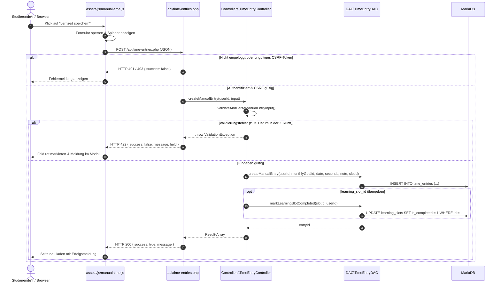

# Dokumentation: Manuelle Zeitnachbuchung (Issue #9)

Dieses Dokument beschreibt die Architektur, Datenhaltung und Funktionsweise der manuellen Zeitnachbuchung im **Lernzeit-Manager** (Modul ISEF01 – Software Engineering, Refs #9).

---

## 1. Ziel und Zweck (Warum & Wofür)

### Wofür wurde es implementiert?
* **Nachträgliches Erfassen von Lernzeiten:** Studierende können außerhalb der Stoppuhr geleistete Lernzeiten (z. B. Lernen in der Bibliothek, im Zug oder mit Offline-Materialien) flexibel für den aktuellen Tag oder vergangene Tage nachbuchen.
* **Zuordnung zu Zielen (Modulen):** Jede Nachbuchung wird verbindlich auf ein Modul (`monthly_goals`) gebucht. Das übergeordnete Semester (`learning_goals`) ergibt sich über den Datenbank-Join.
* **Abhaken geplanter Lerneinheiten:** Liegt am gewählten Tag eine geplante Lerneinheit (`learning_slots`) für das Modul vor, kann diese direkt mitgebucht und automatisch als erledigt markiert werden.
* **Datengrundlage für das Dashboard (Issue #4):** Alle nachgebuchten Zeiten fließen nahtlos über `tracked_seconds` in die aggregierten Monats-, Wochen- und Modulstatistiken ein.

### Warum wurde es so implementiert? (Entwurfsprinzipien)
* **Separation of Concerns (SoC) & Schichtenarchitektur:** Strikte Trennung zwischen wiederverwendbarem UI-Modal ([includes/manual-time-modal.php](../includes/manual-time-modal.php)), asynchronem Endpunkt ([api/time-entries.php](../api/time-entries.php)), Controller mit Validierungslogik ([src/Controllers/TimeEntryController.php](../src/Controllers/TimeEntryController.php)), Datenbankzugriffsschicht ([src/DAO/TimeEntryDAO.php](../src/DAO/TimeEntryDAO.php)) und Datenbank ([sql/schema.sql](../sql/schema.sql)).
* **Single Source of Truth:** Manuelle Buchungen speichern ihre Netto-Lernzeit in `tracked_seconds`. Gemäß DB-Constraint `chk_time_entries_manual` bleiben Start- und Endzeitstempel `NULL`. Das Dashboard muss daher nie zwischen Stoppuhr und Nachbuchung unterscheiden, sondern summiert stets `tracked_seconds`.
* **Progressive Filterung im Frontend:** Zuerst wird der Lerntag gewählt, wodurch die Modulliste automatisch auf die für diesen Monat geplanten Module eingegrenzt wird (keine langen, unübersichtlichen Dropdowns).
* **Wiederverwendbarkeit ohne Redundanz (DRY):** Das Modal liegt als Teilstück in `includes/` und kann über einen Einzeiler auf beliebigen Seiten (Dashboard `index.php`, Wochenansicht `goals.php` etc.) eingebunden werden.

---

## 2. Beteiligte Komponenten & Dateien

```text
lernzeit-manager/
├── api/
│   └── time-entries.php         # Asynchroner JSON-Endpunkt für POST-Anfragen (create, update, delete)
├── assets/
│   └── js/manual-time.js        # Clientseitige Steuerung: dynamische Filterung, Schnellwahl, AJAX-Submit
├── docs/
│   ├── datenbank.md             # Datenbankschema und Tabellenbeziehungen
│   ├── unit-tests.md            # Übersicht aller Unit-Tests
│   └── zeitnachbuchung.md       # Diese Dokumentation
├── includes/
│   └── manual-time-modal.php    # Wiederverwendbares Bootstrap-5-Modal (HTML-Komponente)
├── index.php                    # Dashboard mit Aufruf-Button und Einbindung des Modals
├── src/
│   ├── Controllers/
│   │   └── TimeEntryController.php # Validierung, Geschäftsregeln und Datenaufbereitung
│   └── DAO/
│       └── TimeEntryDAO.php     # PDO Prepared Statements mit Mandantenisolation über user_id
└── tests/Unit/Controllers/
    └── TimeEntryControllerTest.php # 38 PHPUnit-Tests für Validierung und Berechnungen
```

---

## 3. Datenmodell & Validierungsregeln

### Datenbankstruktur ([sql/schema.sql](../sql/schema.sql))
Manuelle Buchungen nutzen die vorbereitete Tabelle `time_entries` aus Issue #29:

* `user_id` (`INT UNSIGNED`): Besitzer des Eintrags (Mandantentrennung).
* `monthly_goal_id` (`INT UNSIGNED`): Fremdschlüssel auf das zugeordnete Modul in `monthly_goals`.
* `learning_slot_id` (`INT UNSIGNED NULL`): Optionaler Fremdschlüssel auf den geplanten Timeslot in `learning_slots` (`ON DELETE SET NULL`).
* `source` (`ENUM('stopwatch','manual')`): Fest auf `'manual'`.
* `entry_date` (`DATE`): Lerntag, an dem die Lernzeit erbracht wurde.
* `started_at`, `ended_at`, `resumed_at`: Bleiben bei manuellen Einträgen `NULL` (erzwungen durch den Datenbank-Constraint `chk_time_entries_manual`).
* `tracked_seconds` (`INT UNSIGNED`): Netto-Lernzeit in Sekunden (`> 0`).
* `note` (`VARCHAR(255) NULL`): Optionale Notiz zur Lerneinheit.

### Validierungsregeln in [`Controllers\TimeEntryController`](../src/Controllers/TimeEntryController.php)

1. **Datum (`entry_date`):**
   * Muss ein gültiges Kalenderdatum im Format `YYYY-MM-DD` sein.
   * Darf nicht in der Zukunft liegen (nur heute oder vergangene Tage).
   * Darf nicht vor dem Jahr 2000 liegen.
2. **Modul (`monthly_goal_id`):**
   * Pflichtfeld. Muss dem eingeloggten Nutzer gehören (Schutz vor IDOR).
   * Muss zum Monat des gewählten Datums gehören (Konsistenz zwischen Lerntag und Modulplanung).
3. **Geplante Lerneinheit (`learning_slot_id`):**
   * Optional. Gehört die gewählte Einheit zum selben Modul und zum selben Tag, wird sie verknüpft und beim Speichern via `TimeEntryDAO::markLearningSlotCompleted()` automatisch als erledigt markiert (`is_completed = 1`).
4. **Dauer (`duration_hours`, `duration_minutes`):**
   * Stunden: Ganzzahl zwischen 0 und 24.
   * Minuten: Ganzzahl zwischen 0 und 59.
   * Gesamtdauer: Mindestens 1 Minute (`TimeEntryController::MIN_DURATION_MINUTES`), maximal 24 Stunden bzw. 1440 Minuten (`TimeEntryController::MAX_DURATION_MINUTES`).
5. **Notiz (`note`):**
   * Optional, maximal 255 Zeichen (`TimeEntryController::MAX_NOTE_LENGTH`).

---

## 4. Asynchrone Schnittstelle & Client-Logik

### [api/time-entries.php](../api/time-entries.php)
* **Authentifizierung:** Nur für angemeldete Nutzer (`User::isLoggedIn()`), sonst HTTP 401.
* **CSRF-Schutz:** Jede Anfrage prüft das sitzungsbasierte CSRF-Token via `hash_equals()`.
* **Aktionen:**
  * `create_manual_entry` (oder `create`): Legt eine Nachbuchung an und hakt ggf. den Timeslot ab.
  * `update_manual_entry`: Bearbeitet einen bestehenden manuellen Eintrag (Stoppuhr-Einträge sind gesperrt).
  * `delete_entry`: Löscht einen Zeiteintrag des berechtigten Nutzers.
* **Antwortformate:**
  * `200 OK`: `{ success: true, message: "...", entry_id: 123, entry: { ... } }`
  * `422 Unprocessable Entity`: `{ success: false, message: "...", field: "entry_date" }`
  * `500 Internal Server Error`: Technischer Fehler (Details nur im Server-Log).

### [assets/js/manual-time.js](../assets/js/manual-time.js)
* **Dynamische Datumsfilterung:** Beim Ändern des Datums werden die Module im Dropdown auf den jeweiligen Kalendermonat gefiltert.
* **Automatische Erkennung geplanter Einheiten:** Existiert für das gewählte Modul am gewählten Tag ein offener Timeslot, blendet sich die Auswahlliste ein und schlägt die geplante Dauer vor.
* **Schnellwahl:** Buttons für `0,5 Std.`, `1 Std.`, `1,5 Std.`, `2 Std.`, `2,5 Std.` und `3 Std.` befüllen die Stunden- und Minutenfelder mit einem Klick.
* **Fehlerbehandlung:** Markiert fehlerhafte Eingabefelder rot (`is-invalid`) und entfernt die Markierung live bei Nutzereingabe.

---

## 5. Ablauf einer manuellen Nachbuchung (Sequenzdiagramm)



---

## 6. Wiederverwendbare Einbindung

Um das Modal auf einer beliebigen Seite zu nutzen:

```php
<!-- 1. Trigger-Button an beliebiger Stelle -->
<button
    type="button"
    class="btn btn-primary"
    data-bs-toggle="modal"
    data-bs-target="#manualTimeModal">
    + Lernzeit nachbuchen
</button>

<!-- 2. Einbindung des Modals vor includes/footer.php -->
<?php
require_once __DIR__ . '/includes/manual-time-modal.php';
require_once __DIR__ . '/includes/footer.php';
?>
```

Das Modal lädt seine JavaScript-Datei [assets/js/manual-time.js](../assets/js/manual-time.js) automatisch über `$extraScripts` im Footer nach.

